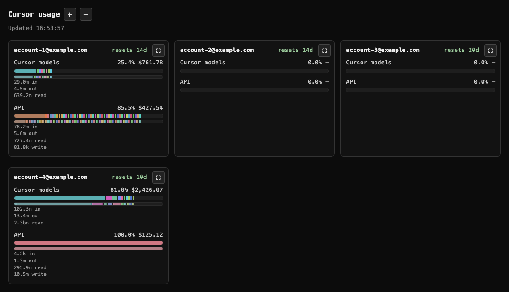
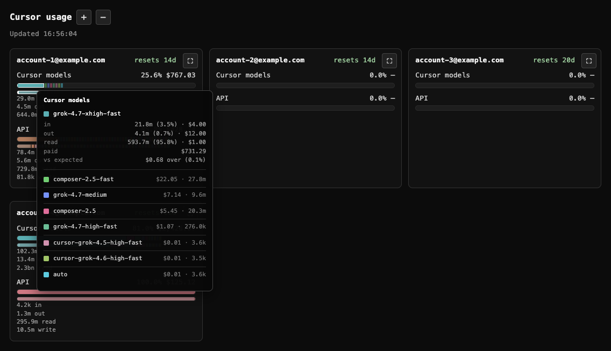
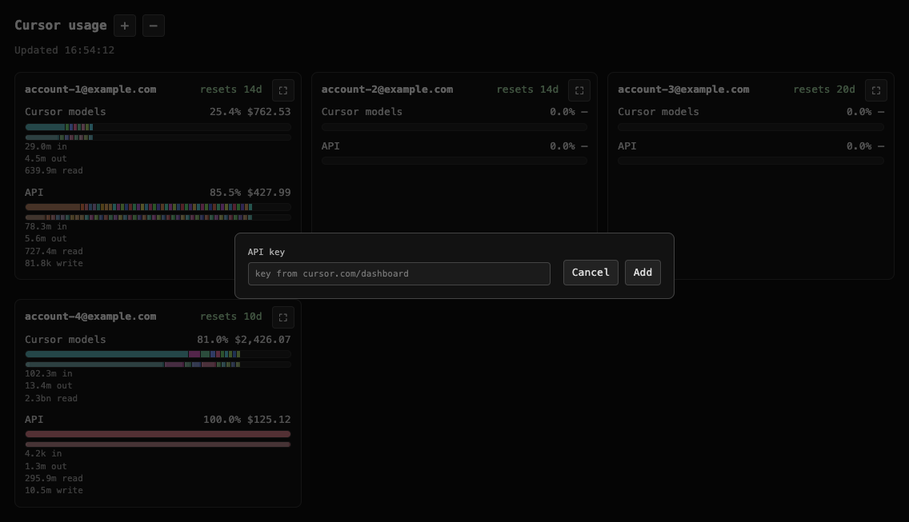
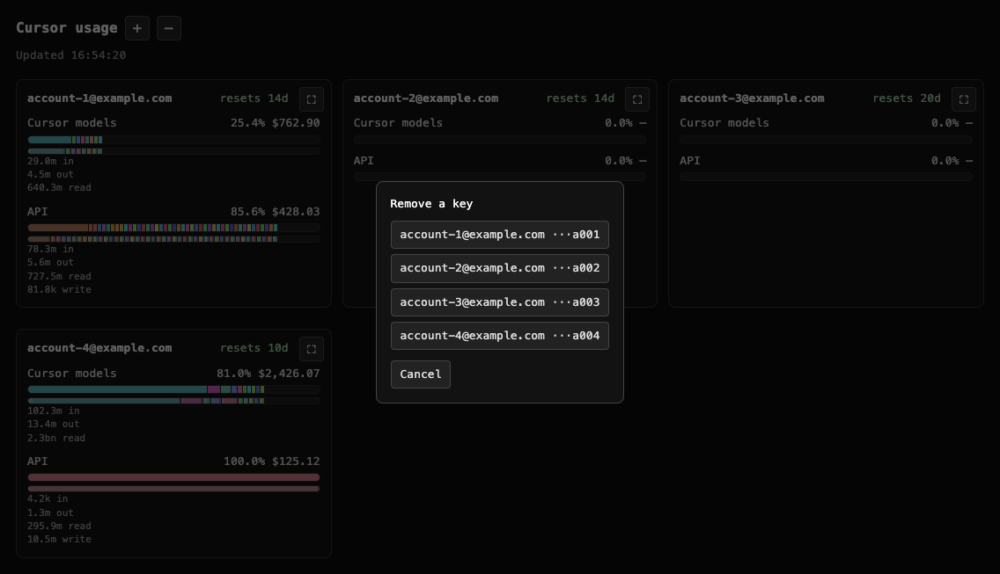

# Cursor usage

A local page for a few Cursor accounts. It shows the reset time, the Cursor-models bar, the API bar, and on-demand spend.

The page reads Cursor every 8 seconds. API keys stay in `keys.json` on the machine. This repo does not contain keys.

The addresses in the pictures are placeholders.

## Accounts



## Model details

Move the pointer over a color in a bar. The list shows every model in that bar. The model under the pointer is open. This picture is `grok-4.7-xhigh-fast` on the first account.



## Add a key

Click **+** next to the title. Paste a key from [cursor.com/dashboard](https://cursor.com/dashboard). The page reads the account email and uses that email as the label.



## Remove a key

Click **−**. Click an account to remove that key.



## Run

Docker is required.

```bash
cp keys.example.json keys.json
docker compose up -d --build
```

Open http://127.0.0.1:8787

You can also add keys in the page. Do not commit `keys.json`.

- `docker compose restart` restarts the running container.
- `docker compose up -d --build` restarts it after a code change. A plain restart keeps the old image.
- `docker compose logs -f` shows the log.

The published port is localhost only. To serve another host, remove `127.0.0.1:` from the port line in `docker-compose.yml`.
